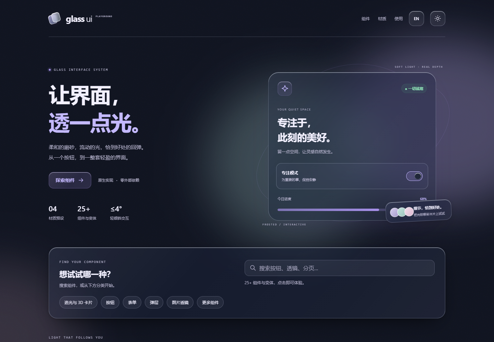
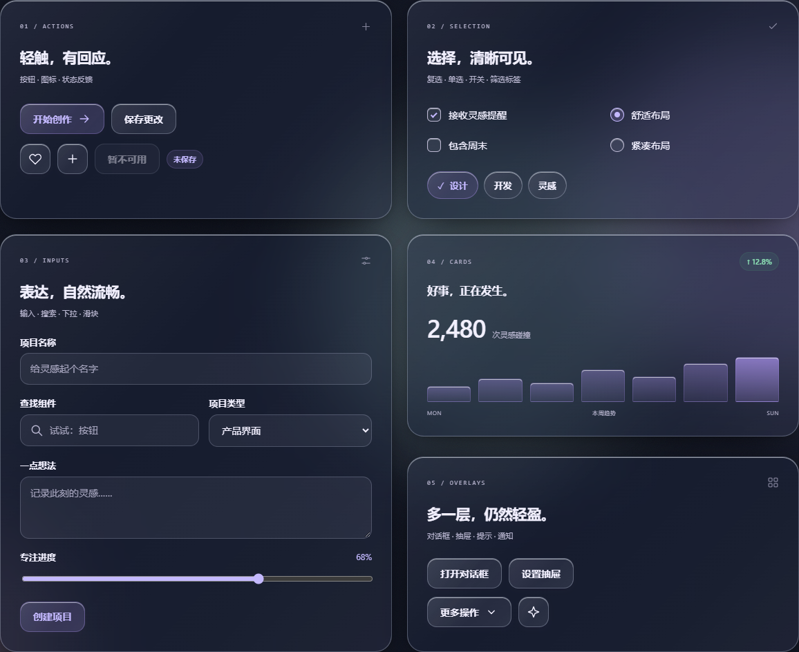
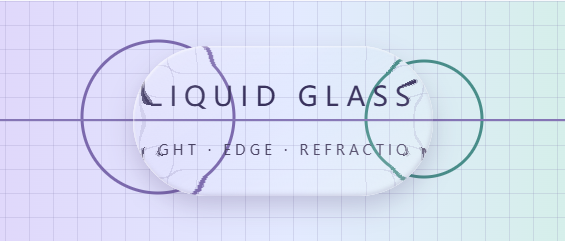

# Glass UI · A portable glass interface skill

[English](README.en.md) | [简体中文](README.md)

**[Explore the live glass components →](https://aivos-xie.github.io/glass-ui/)** · Chinese and English, light and dark themes, material controls, and working interactions.

Reusable glass UI design instructions and component examples for AI agents that can read Markdown and project files. The core follows the [Agent Skills format](https://agentskills.io/specification) and does not depend on Codex, Claude, or vendor-specific tools.

## Install with one message to your agent

Copy this sentence into your agent:

> Install the Glass UI skill from https://github.com/aivos-xie/glass-ui, read INSTALL.en.md first, choose the installation or instruction integration supported by your current agent, verify it, and report the installation path.

The agent follows the [installation guide](INSTALL.en.md) to select its own destination. Hosts with native skills use native discovery. Other hosts can load the skill through project instructions. A chat-only product without file or configuration access can use the instructions for the current conversation, but cannot claim a persistent installation.

This repository is public and can be read and installed directly. Your agent still needs network access to GitHub.

## Supported environments

| Environment | Integration |
| --- | --- |
| Codex, Claude Code, Cursor, Gemini CLI, GitHub Copilot, OpenCode, Cline, Windsurf, and other supported hosts | Select the matching agent in Skills CLI and install the complete resource directory |
| Other hosts supporting Agent Skills or `SKILL.md` | Copy the directory to the skill location documented by that host |
| Hosts with project instructions but no native skills | Store the resources locally and add a small instruction that loads them when relevant |
| Custom agents and API workflows | Load `SKILL.md` as task instructions and provide its referenced resources as needed |

Capabilities depend on the host's file, editing, terminal, and browser tools. Installation checks and runtime tests in individual products are reported separately.

## Terminal installation

The tested installer is `skills@1.9.0`, which requires Node.js 22.20.0 or newer and Git. These are installer requirements, not runtime dependencies of Glass UI.

```bash
# Example for Claude Code; replace claude-code with your agent's identifier.
npx --yes skills@1.9.0 add aivos-xie/glass-ui --skill glass-ui --agent claude-code --global --copy --yes
```

Common identifiers are `codex`, `claude-code`, `cursor`, `gemini-cli`, `github-copilot`, `opencode`, `cline`, and `windsurf`. [Skills CLI](https://github.com/vercel-labs/skills/blob/main/docs/agents.md) maintains the full list and directory mappings.

For a project-only installation, omit `--global` and run from the project root. To install for several explicitly selected agents, use arguments such as `--agent claude-code cursor`. Without Node.js, or for another host, follow the [installation path without the CLI](INSTALL.en.md#installation-without-the-cli).

## Use the skill

After installation, ask:

> Use the Glass UI skill to add frosted glass cards, pointer-lit borders, and a sliding selection pill to this page while preserving its existing behavior.

Hosts with explicit skill syntax can also use their own syntax, such as `$glass-ui` in Codex. A request for one switch, form, button, or navigation component only needs that component; it does not require the entire demo.

## Interactions



- **Glass cards:** a soft pointer spotlight, local border highlights, a maximum total tilt of 4°, and smooth reset on exit.
- **Selection pills:** directional stretching, a small spring settle, continuous rapid retargeting, and undistorted foreground labels.
- **Component system:** frosted, clear liquid, tinted, and prism-edge treatments for buttons, options, forms, navigation, menus, and overlays.
- **Usability:** keyboard and touch behavior, reduced motion, forced colors, and a fallback when backdrop blur is unavailable.

Open the [offline demo](assets/demo/index.html) directly. It needs no build step, remote fonts, images, or scripts. This baseline sample uses Chinese labels; the online showcase provides a Chinese/English language switch.



See also the [mobile screenshot](docs/preview-mobile.png).

## Enhanced capabilities

- **Choose a rendering route:** distinguish frosted surfaces, known-image refraction, arbitrary DOM backdrops, and video/shader work requiring additional implementation. Keep their compatibility evidence separate.
- **Movable image lenses and vertical navigation:** align the image layer, reuse displacement maps during movement, and support horizontal/vertical/RTL pills with disabled-item skipping.
- **Quality and readability controls:** full / balanced / static modes, with independent responses to reduced transparency, increased contrast, and reduced motion.
- **Platform examples:** a Flutter SDK frosted container, a mini-program component with a solid default, and integration guidance for Apple, Android, desktop, and uni-app.
- **Repeatable validation:** a multi-engine browser script with actual results and untested platforms recorded separately.

See [research notes](docs/en/research-notes.md) for all five references, reviewed revisions, and adoption decisions. New implementations were written independently, without copying third-party code or images.



## Documentation

| Topic | English | 简体中文 |
| --- | --- | --- |
| Installation | [Installation guide](INSTALL.en.md) | [安装说明](INSTALL.md) |
| Skill instructions | [Skill guide](docs/en/skill-guide.md) | [Skill 入口](SKILL.md) |
| Materials and motion | [Reference](docs/en/materials-and-motion.md) | [材质与交互](references/materials-and-motion.md) |
| Components | [Recipes](docs/en/components.md) | [组件配方](references/components.md) |
| Framework integration | [Implementation](docs/en/implementation.md) | [实现与选库](references/implementation.md) |
| Validation | [Checklist](docs/en/validation.md) | [验收清单](references/validation.md) |
| Design decisions | [Material hierarchy and brand](docs/en/design-system.md) | [设计决策](references/design-system.md) |
| Rendering and performance | [Routes and image lenses](docs/en/rendering-and-performance.md) | [渲染与性能](references/rendering-and-performance.md) |
| Platform adapters | [Native and mini-program guidance](docs/en/platform-adapters.md) | [平台适配](references/platform-adapters.md) |
| Reference projects | [Research and adoption decisions](docs/en/research-notes.md) | [参考记录](references/research-notes.md) |
| Online showcase | [Usage and publishing](docs/en/website.md) | [体验与发布](docs/website.md) |

```text
SKILL.md                     Shared skill entrypoint
README.en.md / README.md      English and Simplified Chinese overview
INSTALL.en.md / INSTALL.md    Installation instructions for the agent
agents/openai.yaml           Optional Codex metadata; other hosts may ignore it
references/                  Original material, component, and validation references
docs/en/                     English skill guide and technical references
assets/demo/                 Standalone HTML / CSS / JavaScript examples
assets/adapters/             Flutter and mini-program baseline containers
scripts/check_assets.py      Local resource, link, and basic semantic checks
scripts/validate_browser.mjs Optional multi-engine checks and screenshots
docs/                        Screenshots and validation records
docs/index.html              GitHub Pages showcase (main branch, /docs)
```

## Validation

The [showcase validation record](docs/website-validation.json) reports 19 passing checks for language switching, component search, code and configuration copying, configuration downloads, and responsive layouts. The [showcase core record](docs/website-core-validation.json) reports 66 passing checks across Edge, Firefox, and Playwright WebKit. See the [showcase guide](docs/en/website.md) to reproduce them.

The [browser validation record](docs/browser-validation.json) reports 66 passing checks on Windows on 2026-11-21: 22 each in Edge, Firefox, and Playwright WebKit, with no skips. These cover existing interactions, vertical navigation, image-refraction pixel differences, quality settings, and accessibility fallbacks. The WebKit result is not Safari or physical iPhone certification.

The [adapter validation record](docs/adapter-validation.json) reports no static-analysis issues and four passing widget tests with Flutter 3.44.8. The mini-program adapter has only received source checks, with no DevTools or physical-device run. Apple and Android native guidance has not been compiled or validated on devices.

The [historical UI validation record](docs/validation.json) retains the initial 20 checks. See [validation instructions](docs/en/validation.md) for the new suite and its scope.

The [installation validation record](docs/installation-validation.json) reports installation checks separately. It does not claim runtime testing inside every supported agent product.

Run the resource checker with Python 3 and its standard library:

```bash
python scripts/check_assets.py
```

When integrating into a project, use the [implementation reference](docs/en/implementation.md) and validate the project's actual framework, backgrounds, browsers, and interactions.
