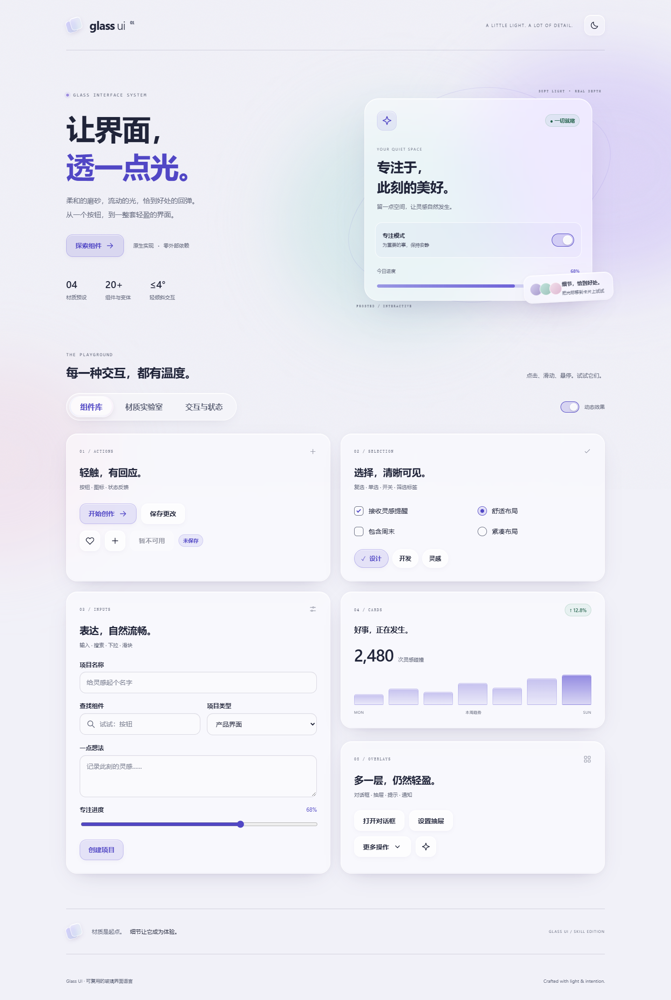
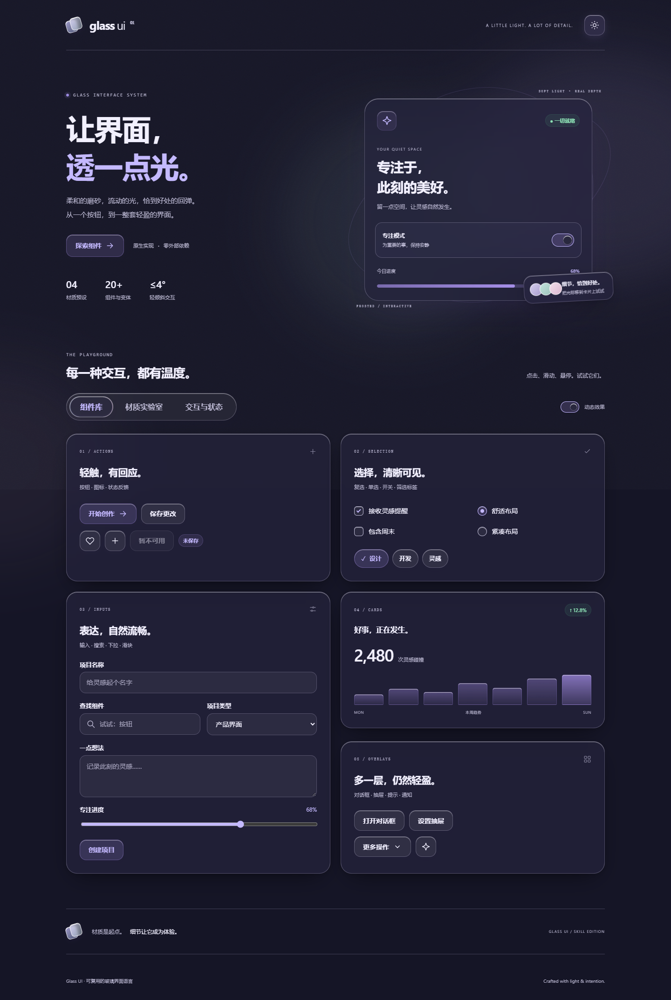

# Glass UI · 玻璃界面 Skill

为 Codex 提供一套可复用的玻璃 UI 设计规则与无依赖组件样板，覆盖磨砂、清透液态、染色和棱镜边缘，以及按钮、选项、表单、卡片、导航和弹层。



## 交互效果

- **玻璃卡片**：柔和光斑跟随光标，附近边框局部提亮，整体 3D 倾角不超过 4°，移出后平滑复原。
- **选中胶囊**：共享指示器沿切换方向拉伸，到位弹性回弹；快速切换时保持运动连续，文字和图标不被拉伸。
- **整套控件**：按钮、复选框、单选框、开关、分段选择器、输入框、滑块、标签页、菜单、提示和对话框使用一致的材质与状态反馈。
- **可用性**：支持键盘操作、触屏、减少动态效果、强制颜色，以及无背景模糊时的回退。

## 安装与调用

将仓库克隆到 Codex 的技能目录。Windows PowerShell 示例：

```powershell
git clone https://github.com/aivos-xie/glass-ui.git "$env:USERPROFILE\.codex\skills\glass-ui"
```

macOS / Linux 示例：

```bash
git clone https://github.com/aivos-xie/glass-ui.git ~/.codex/skills/glass-ui
```

私有仓库需要先配置对应 GitHub 账号的 Git 访问权限。目录已存在时，先保留自己的修改，再决定更新方式。

安装后可在 Codex 中使用：

```text
使用 $glass-ui 为当前页面加入磨砂玻璃卡片、追光边框和滑动选中胶囊，保留现有业务行为。
```

也支持按需调用，例如只实现一个玻璃开关、表单或导航，无需引入整套展示页面。

## 离线演示

直接在浏览器中打开 [assets/demo/index.html](assets/demo/index.html)。演示没有构建步骤，也不依赖远程字体、图片或脚本。



移动端布局见 [移动端截图](docs/preview-mobile.png)。

## 文件结构

```text
SKILL.md                     技能入口、使用范围和核心约束
agents/openai.yaml           Codex 中的名称、提示和自动调用设置
references/                  材质、组件配方、实现方式与验收规则
assets/demo/                 原生 HTML / CSS / JavaScript 交互示例
scripts/check_assets.py      资源、引用与基础语义检查
docs/                        演示截图和验证记录
```

## 验证与边界

2026 年 11 月 21 日的 [验证记录](docs/validation.json) 包含 20 项通过结果，覆盖倾角限幅、快速切换、键盘与焦点、表单、弹层、减少动态效果、窄屏布局及控制器清理。

实测浏览器为 Microsoft Edge / Chromium；Safari 与 Firefox 尚未实测。SVG 场景折射是单独验证的增强效果，不能据此推定任意页面背景的折射兼容性。基础玻璃材质在增强不可用时继续工作。

资源检查可运行：

```bash
python scripts/check_assets.py
```

接入现有项目时，按需使用 [实现说明](references/implementation.md)，并针对项目实际框架、背景、浏览器和交互重新验证。
