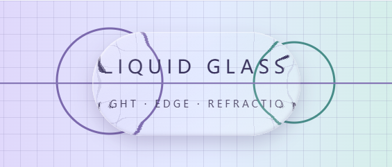

# Glass UI · 通用玻璃界面 Skill

[简体中文](README.md) | [English](README.en.md)

**[在线体验玻璃组件 →](https://aivos-xie.github.io/glass-ui/)** · 支持中英文、深浅主题、材质调节和完整交互。

[下载完整 Skill 压缩包](https://github.com/aivos-xie/glass-ui/releases/latest/download/glass-ui.zip) · 解压后先阅读 `glass-ui/INSTALL.md`，按当前 Agent 的方式安装。

[直接体验追光与 3D 卡片](https://aivos-xie.github.io/glass-ui/#spotlight-demo)：观察卡片内部跟光、局部边框高光、最多 4° 的倾斜和移出复原。

给能读取 Markdown 和项目文件的 AI Agent 使用的玻璃 UI 设计规则与组件样板。核心指令不依赖 Codex、Claude 或任何厂商专用工具，采用 [Agent Skills 开放格式](https://agentskills.io/specification)。

## 给 Agent 一句话就能安装

复制下面这句话，发给你正在使用的 Agent：

> 请从 https://github.com/aivos-xie/glass-ui 安装 Glass UI Skill，先阅读 INSTALL.md，按你当前 Agent 的方式安装或接入并验证，完成后告诉我安装位置。

Agent 会根据 [安装说明](INSTALL.md) 选择自己的安装位置。支持原生 Skill 的产品使用原生发现机制；没有原生 Skill 的产品可使用本地指令文件接入。只有聊天、没有文件或工具权限的产品可以阅读内容用于当前会话，但不能宣称已经持久安装。

本仓库公开，可直接读取和安装；Agent 仍需能访问 GitHub。

## 支持哪些 Agent

| 环境 | 接入方式 |
| --- | --- |
| Codex、Claude Code、Cursor、Gemini CLI、GitHub Copilot、OpenCode、Cline、Windsurf 等 | 使用 Skills CLI 选择对应 Agent，安装完整资源目录 |
| 其他支持 Agent Skills / `SKILL.md` 的 Agent | 放进该产品文档指定的 Skill 目录 |
| 没有原生 Skill、但支持项目指令的 Agent | 保存完整目录，再在项目指令中添加一条按需读取入口 |
| 自定义 Agent / API 工作流 | 读取 `SKILL.md` 作为任务指令，按需提供其引用文件 |

支持程度取决于宿主的文件读取、代码编辑、终端和浏览器能力；“安装成功”与“在每个产品里完成交互实测”分别记录。

## 终端安装

下面使用已经验证过的 `skills@1.9.0`；它需要 Node.js 22.20.0 或更新版本及 Git。它们是安装器的要求，Glass UI 本身没有这些运行依赖。

```bash
# Claude Code 示例；把 claude-code 换成当前 Agent 的标识。
npx --yes skills@1.9.0 add aivos-xie/glass-ui --skill glass-ui --agent claude-code --global --copy --yes
```

常用标识：`codex`、`claude-code`、`cursor`、`gemini-cli`、`github-copilot`、`opencode`、`cline`、`windsurf`。完整列表和当前目录映射由 [Skills CLI](https://github.com/vercel-labs/skills/blob/main/docs/agents.md) 维护。

若用户只要求当前项目可用，去掉 `--global`，在项目根目录执行。一次安装给多个指定 Agent，可写成 `--agent claude-code cursor`。无 Node.js 或不在支持列表中的环境，使用 [无需 CLI 的安装路径](INSTALL.md#无需-cli-的安装路径)。

## 使用

安装后可以直接说：

> 使用 Glass UI Skill 为当前页面加入磨砂玻璃卡片、追光边框和滑动选中胶囊，保留现有业务行为。

支持显式 Skill 命令的 Agent 也可以使用自己的原生语法，例如 Codex 的 `$glass-ui`。单个开关、表单、按钮或导航的请求只实现对应组件，无需引入整套展示页。

也可以直接指定要生成或改造的组件：

> 使用 Glass UI Skill，为当前项目生成一个有加载状态的玻璃按钮，沿用现有提交逻辑。
>
> 使用 Glass UI Skill，给现有卡片加入磨砂、内部追光和最多 2° 的倾斜。
>
> 使用 Glass UI Skill，生成玻璃风格的数据表格，接入现有数据、排序与分页。

组件名称、内容、状态、材质和交互都可用自然语言描述，不必填写固定参数表。Agent 根据当前技术栈生成项目内的实际源文件、接入代码并验证；未列在[组件配方](references/components.md)中的组件也按其语义和结构组合实现。自然语言要求中的倾角等选项由 Agent 实现，不是现有控制器的同名参数。生成后的组件随项目运行。

## 交互效果


- **玻璃卡片**：柔和追光、局部边框高光、最高 4° 的整体倾斜和离开复原。
- **选中胶囊**：沿切换方向拉伸、到位弹性回弹、连续快速切换，前景文字不被拉伸。
- **组件体系**：磨砂、清透液态、染色、棱镜边缘；覆盖按钮、选项、表单、导航、菜单和弹层。
- **可用性**：键盘、触屏、减少动态效果、强制颜色和无模糊回退。

直接打开 [离线演示](assets/demo/index.html)，无需构建，也没有远程字体、图片或脚本。


以上为新版展示站的实际截图，默认深色主题。另有[浅色预览](docs/preview-light.png?v=20261121-dark-glass)与[移动端截图](docs/preview-mobile.png?v=20261121-dark-glass)。

## 增强能力

- **按场景选择渲染**：区分普通磨砂、指定图片折射、任意 DOM backdrop 和需要额外实现的视频/shader；不混用兼容性结论。
- **可移动图片透镜与纵向导航**：图片层保持对齐，移动时复用位移图；胶囊支持横向、纵向、RTL 和禁用项跳过。
- **质量与可读性设置**：full / balanced / static 三档，减少透明度、增加对比度和减少动态分别响应。
- **平台样板**：新增 Flutter SDK 磨砂容器、默认实色的小程序组件，并提供 Apple、Android、桌面和 uni-app 接入指南。
- **可重复验证**：附多引擎浏览器测试脚本；实际结果与未验证平台分开记录。

五个参考项目、阅读版本和采用/未采用的思路见[参考记录](references/research-notes.md)。新增实现独立编写，未复制第三方代码或图片。



## 多语言文档

中英文文档覆盖项目说明、安装步骤、Skill 使用指南、材质与交互、组件配方、框架接入和验收要求。在线展示站可切换中文与英文；`assets/demo/` 中的基础离线样板使用中文。

| 内容 | 简体中文 | English |
| --- | --- | --- |
| 安装 | [安装说明](INSTALL.md) | [Installation guide](INSTALL.en.md) |
| Skill 使用 | [Skill 入口](SKILL.md) | [Skill guide](docs/en/skill-guide.md) |
| 材质与交互 | [参考说明](references/materials-and-motion.md) | [Materials and motion](docs/en/materials-and-motion.md) |
| 组件 | [组件配方](references/components.md) | [Component recipes](docs/en/components.md) |
| 框架接入 | [实现与选库](references/implementation.md) | [Implementation](docs/en/implementation.md) |
| 验收 | [验收清单](references/validation.md) | [Validation](docs/en/validation.md) |
| 设计决策 | [材质层级与品牌](references/design-system.md) | [Design decisions](docs/en/design-system.md) |
| 渲染与性能 | [路线与图片透镜](references/rendering-and-performance.md) | [Rendering and performance](docs/en/rendering-and-performance.md) |
| 平台适配 | [原生与小程序](references/platform-adapters.md) | [Platform adapters](docs/en/platform-adapters.md) |
| 参考项目 | [阅读与取舍](references/research-notes.md) | [Research notes](docs/en/research-notes.md) |
| 在线展示站 | [体验与发布](docs/website.md) | [Showcase and publishing](docs/en/website.md) |

## 文件结构

```text
SKILL.md                     所有 Agent 共用的核心指令
README.md / README.en.md      中英文项目说明
INSTALL.md / INSTALL.en.md    给执行安装任务的 Agent 阅读
agents/openai.yaml           可选 Codex 元数据，其他 Agent 可忽略
references/                  材质、组件配方、实现与验收规则
docs/en/                     英文使用指南与技术参考
assets/demo/                 无依赖 HTML / CSS / JavaScript 样板
assets/adapters/             Flutter 与小程序基础容器
scripts/check_assets.py      资源、引用和基础语义检查
scripts/validate_browser.mjs 可选多引擎回归与截图
docs/                        演示截图与验证记录
docs/index.html              GitHub Pages 展示站入口（main 分支 /docs）
```

## 验证

[在线展示站验证](docs/website-validation.json)：19 项站点检查通过，覆盖默认深色、中英文切换、组件搜索、代码与配置复制、配置下载和响应式布局。[追光卡片验证](docs/card-hover-validation.json)：Edge、Firefox、Playwright WebKit 共 57 项通过，包含真实指针追光、局部边框、倾角限幅与退出复原。[材质与降级验证](docs/material-validation.json)单独记录深色材质及实色回退。复现方法见[展示站说明](docs/website.md)。

[离线样板验证记录](docs/browser-validation.json)：2026-11-21 在 Windows 上运行 Edge、Firefox 和 Playwright WebKit，每个引擎 22 项，共 66 项通过，无跳过。覆盖默认深色与主题切换、原有交互、纵向导航、图片折射像素差、质量与无障碍回退。WebKit 结果不代表 Safari 或 iPhone 真机认证。

[平台样板验证记录](docs/adapter-validation.json)：Flutter 3.44.8 静态分析无问题，4 项 widget tests 通过；小程序仅完成源文件检查，尚未在开发者工具和真机运行。Apple、Android 原生指南也未作编译或真机验证。

[历史界面验证记录](docs/validation.json)保留首版的 20 项检查，[历史站点核心记录](docs/website-core-validation.json)保留此前站点的 66 项检查。新版测试命令与判定范围见[验收说明](references/validation.md)。

跨 Agent 的安装验证单独见 [安装验证记录](docs/installation-validation.json)，不把目录安装检查当成各产品的运行验证。

资源检查使用 Python 3 标准库：

```bash
python scripts/check_assets.py
```

接入项目时按需参考 [实现说明](references/implementation.md)，并针对项目实际框架、背景、浏览器与交互重新验证。
